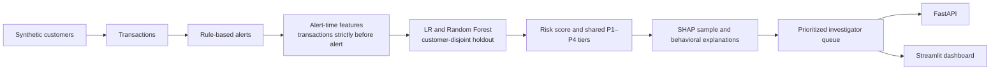

# AML Alert Triage Engine

A synthetic end-to-end AML alert triage product for demonstrating a reproducible investigator workflow. It generates customers, transactions, and rule-based alerts; builds time-aware features; trains Logistic Regression and Random Forest models; scores and explains alerts; and produces a prioritized queue for the API and Streamlit dashboard.

Scores and explanations are decision support. They do not establish wrongdoing; human review is required.

## Architecture



## Setup

Use Python 3.12 from the repository root:

```bash
python3.12 -m venv .venv
source .venv/bin/activate
python -m pip install -r requirements.txt
```

All dependencies are pinned to versions exercised by the pipeline and tests.

## Investigator dashboard

The Streamlit app (`src/dashboard/app.py`) is laid out like a case-management tool, with top navigation:

- **Start here** – a two-minute scroll story for people new to AML: a pinned 3D scene (three.js, driven by GSAP ScrollTrigger) shows payments becoming alerts, alerts being scored, scores sorting into P1–P4 and where the investigator takes over, using the live dataset's numbers. Followed by a first-five-minutes guide, what each priority means and a plain-English glossary. Every other page has a *New here? What am I looking at?* explainer.
- **Overview** – the 3D alert galaxy (distance from the core is inverse to risk, color is the P1–P4 tier, P1 pulses), headline KPIs, a "Needs attention" list of open P1 alerts and the workload by tier.
- **Work queue** – search plus priority, alert-type and case-status filters; click any row to open the case. Export the current view as CSV.
- **Case** – one alert: animated risk gauge, plain-English reasons it was flagged, its top SHAP drivers, the customer's transaction history around the alert, a customer profile, other alerts for the same customer, and case actions (status, assignee, notes, *Save & next*). Previous/Next follow the queue order. Deep link with `?alert=A003809`.
- **Insights** – interactive 3D risk explorer (drag to rotate, hover for details) and population analytics.
- **Model** – held-out metrics, how often each tier was right, global SHAP importance, and data quality.

Case actions are session-only by design and never change the dataset. The synthetic investigation outcome is kept out of the queue and shown only under "Evaluation label" on the case page. Motion respects `prefers-reduced-motion`, 3D rendering pauses off screen, and views fall back to static content without WebGL. Three.js and GSAP are vendored under `src/dashboard/static/vendor/` and served with Streamlit static serving (`enableStaticServing` in `.streamlit/config.toml`), with a jsDelivr fallback.

## Run the pipeline

Build the hosted-demo dataset (1,500 customers, 30,000 base transactions, about 23,000 alerts; about 50 seconds). It is large enough for a meaningful customer-disjoint holdout, and SHAP is bounded to 1,500 local explanations in this mode:

```bash
python run_pipeline.py --demo
```

Build the full synthetic dataset (10,000 customers and 200,000 base transactions):

```bash
python run_pipeline.py
```

Set a custom size and seed:

```bash
python run_pipeline.py --n-customers 5000 --n-transactions 100000 --seed 42
```

The stages overwrite deterministic generated outputs, so reruns are idempotent. Generated CSVs, Parquet files, and model binaries stay local and are ignored by Git. To write the final queue as Parquet or a smaller dashboard/API CSV:

```bash
python run_pipeline.py --demo --output-format parquet
python run_pipeline.py --demo --output-format trimmed-csv
```

For Parquet, set `AML_ALERTS_DATA_PATH=data/processed/aml_prioritized_alerts.parquet` when starting the API or dashboard. The trimmed CSV includes the fields consumed by those applications.

## Start the applications

The dashboard builds the demo data automatically on first launch (set `AML_AUTO_BUILD_DEMO=0` to disable this). To prepare it from a fresh clone with one command:

```bash
python ensure_demo_data.py
```

Start the dashboard:

```bash
streamlit run src/dashboard/app.py
```

Start the API in another terminal:

```bash
uvicorn src.api.app:app --reload
```

The API provides `/`, `/health`, `/stats`, `/alerts`, `/alerts/{alert_id}`, `/alerts/{alert_id}/explanation`, and `/model`. `/alerts` supports priority, risk level, alert type, date range, sorting, and bounded pagination. The queue is loaded once when the service starts.

## Priority tiers

One shared definition in `src/triage_config.py` maps risk scores to risk levels and priorities. Queue heuristics only order alerts inside each tier.

| Priority | Risk level | Score | Meaning |
|---|---|---:|---|
| P1 | CRITICAL | 73–100 | Prompt human review |
| P2 | HIGH | 47–72 | Elevated review queue |
| P3 | MEDIUM | 25–46 | Standard review queue |
| P4 | LOW | 0–24 | Lower review urgency |

Thresholds were calibrated on the score distribution from a customer-disjoint holdout and the full synthetic queue. On the 155,927-alert run, the queue shares were P1 1.16%, P2 6.31%, P3 92.49%, and P4 0.03%. The held-out shares were 1.04%, 6.78%, 92.17%, and 0.02%.

## Model evaluation

The earlier random-row split produced higher metrics but could place a customer's alerts in both training and test data. The current evaluation uses a deterministic customer-grouped split and alert-time aggregates.

| Model | Split / feature set | PR-AUC | ROC-AUC |
|---|---|---:|---:|
| Logistic Regression | Earlier random split, full-history aggregates | 0.361 | 0.653 |
| Random Forest | Earlier random split, full-history aggregates | 0.412 | 0.665 |
| Logistic Regression | Customer-disjoint, pre-alert aggregates | 0.271 | 0.589 |
| Random Forest | Customer-disjoint, pre-alert aggregates | 0.325 | 0.620 |

Held-out RF precision and recall by priority tier use the synthetic `is_suspicious` ground truth strictly for evaluation:

| Tier | Held-out alerts | Precision (% truly suspicious) | Recall (share of truly suspicious alerts) |
|---|---:|---:|---:|
| P1 | 326 | 100.0% | 13.7% |
| P2 | 2,134 | 56.0% | 50.1% |
| P3 | 29,021 | 3.0% | 36.2% |
| P4 | 5 | 0.0% | 0.0% |

These figures describe one seeded synthetic run, not expected real-world performance. P4 has very few holdout examples.

## Data and leakage notes

- All records are synthetic. `is_suspicious` is never a model feature; it is used only to synthesize outcomes and to calculate held-out evaluation metrics.
- `investigation_outcome` supplies the training target but is excluded from the feature matrix.
- Customer transaction count, amount statistics, counterparty/country counts, outgoing ratio, and rolling activity are computed from transactions strictly before the alert timestamp. The alerting transaction and later transactions are excluded.
- Train/test assignment is grouped by `customer_id`; the same customer cannot appear in both sets.
- Seeds are fixed by default (`42`) and can be changed with `--seed`.
- Local investigator notes/status are held in Streamlit session state and are not persisted to source data.

## Limitations

This project demonstrates an engineering workflow on synthetic data. It is not a regulatory system, a production AML control, or a substitute for investigator judgment, validation, governance, or applicable legal and compliance procedures. SHAP values describe model behavior; they do not establish causation or wrongdoing.

## Project structure

```text
run_pipeline.py                 CLI pipeline entry point
ensure_demo_data.py             Generate demo artifacts only when absent
src/data/                       Synthetic generators and time-aware features
src/models/                     Training and customer-group split helpers
src/scoring/                    Risk scoring and held-out tier evaluation
src/triage_config.py            Shared score thresholds and priority mapping
src/explainability/             SHAP and behavioral explanations
src/prioritization/              Investigator queue construction
src/api/app.py                  Cached FastAPI service
src/dashboard/app.py            Streamlit investigator workspace
src/dashboard/visuals.py        3D/animated components (three.js + GSAP, rendered with st.iframe)
src/dashboard/static/vendor/    Vendored three.js r158 (MIT) and GSAP 3.12 served via static serving
tests/                          Deterministic unit, API, and demo smoke tests
models/*.json                   Small evaluation and stage summaries
```

More detail: [MODEL_CARD.md](MODEL_CARD.md) and [DEPLOY.md](DEPLOY.md).
